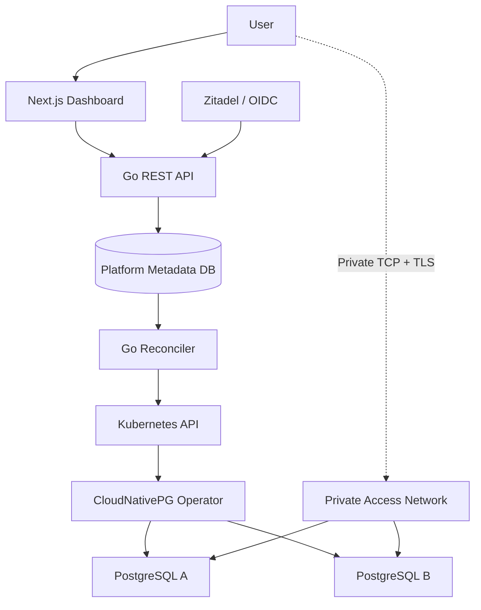
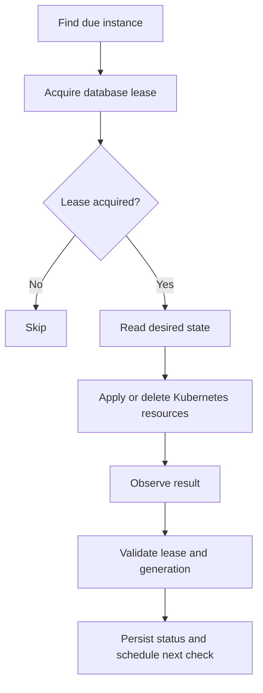
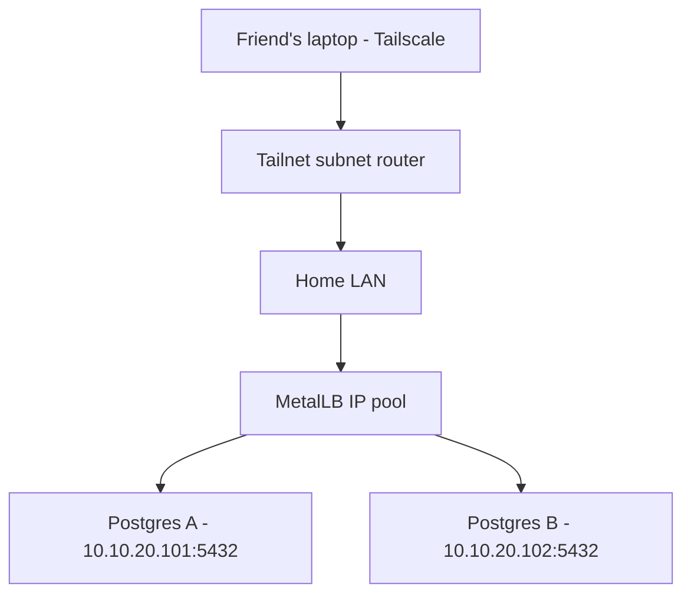
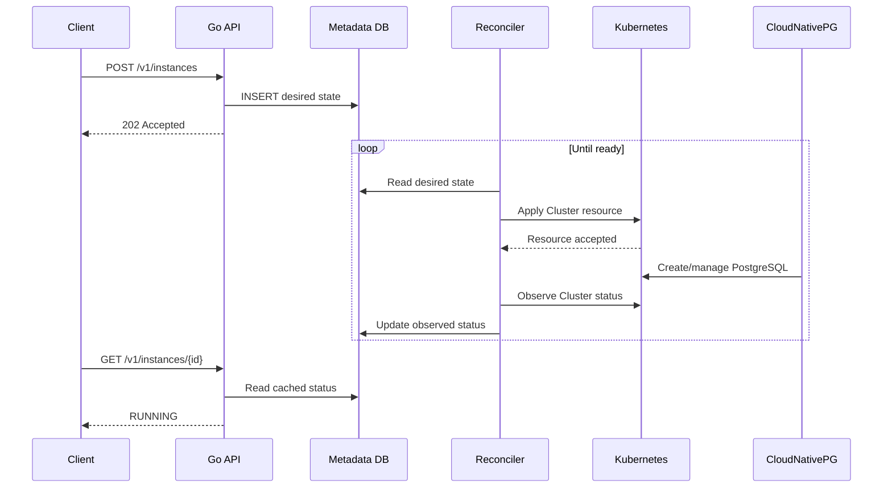

# PostgreSQL Cloud Platform: Detailed Implementation Plan

**Version:** 1.0  
**Date:** October 2026  
**Stack:** Kubernetes, Go, PostgreSQL, CloudNativePG, Next.js

## 1. Project goal

Build a self-service PostgreSQL hosting platform on a homelab Kubernetes cluster.

Users should be able to visit a website, authenticate, create their own PostgreSQL instance, and receive a secure endpoint they can use from their laptop or application.

The platform should automatically manage provisioning, monitoring, deletion, resource isolation, and recovery from ordinary infrastructure failures.

### Target user experience

1. A user signs in to the dashboard.
2. They choose **Create PostgreSQL**.
3. They select a name, PostgreSQL version, and plan.
4. The platform returns a provisioning status immediately.
5. The reconciler provisions their database using CloudNativePG.
6. The dashboard displays `RUNNING`, a private hostname, and secure connection instructions.
7. The user connects and stores data.
8. The user can inspect and delete their instance.

Example plans:

| Plan | CPU | RAM | Storage |
|---|---:|---:|---:|
| Nano | 250m | 512 MiB | 5 GiB |
| Small | 500m | 1 GiB | 10 GiB |

Example endpoint: `pg-a1b2.db.example.internal:5432`.

## 2. Scope and architectural decisions

Build the first version around **one managed service type: PostgreSQL using CloudNativePG**.

| Area | MVP decision |
|---|---|
| Runtime | Existing Kubernetes cluster |
| Language | Go |
| Frontend | Next.js + TypeScript |
| Metadata database | PostgreSQL |
| PostgreSQL operator | CloudNativePG |
| Reconciliation | Custom Go controller |
| Authentication | OIDC, preferably Zitadel |
| Multi-tenancy | One namespace per organization |
| Database instances | One primary, no replicas |
| Instance sizes | Two predefined plans |
| Networking | Private access first |
| Deployment | Argo CD for the platform itself |
| Backups | External object storage before inviting users |
| Billing | Out of scope |

**Do not build a custom PostgreSQL operator.** The platform reconciler creates CloudNativePG `Cluster` custom resources. CloudNativePG manages the underlying PostgreSQL Pods, storage integration, lifecycle, and primary service.

The initial platform needs:

- Instance creation, listing, inspection, and deletion.
- Durable desired state and asynchronous provisioning.
- Automatic recovery from reconciler crashes.
- Multi-tenant authorization and resource quotas.
- Secure database access outside the cluster.
- Backup and restoration.
- Basic operational monitoring.

Defer resizing, major-version upgrades, additional database users, high availability, public internet access, and billing.

## 3. High-level system design



There are three distinct state-management layers:

| Layer | Source of truth | Responsibility |
|---|---|---|
| Platform control plane | Metadata PostgreSQL | What each customer requested |
| Kubernetes | Kubernetes API / etcd | Which infrastructure resources currently exist |
| CloudNativePG | Cluster CRD, status, PostgreSQL runtime | Maintaining database health and configuration |

The Go reconciler is the bridge between the first two layers.

A successful `POST /instances` must not wait for PostgreSQL to finish provisioning. It commits the desired configuration, returns `202 Accepted`, and lets the controller work asynchronously.

## 4. Delivery roadmap

**Estimated effort: 70–115 engineering hours.** This is an estimate for a working, tested PostgreSQL-only MVP. Actual time depends on homelab infrastructure.

| Phase | Workstream | Estimate |
|---|---|---:|
| 1 | Kubernetes + CloudNativePG | 6–10h |
| 2 | Backend and database | 10–15h |
| 3 | Provisioning reconciler | 15–22h |
| 4 | Deletion, retries, recovery | 10–16h |
| 5 | Private access + tenancy | 10–16h |
| 6 | Authentication + dashboard | 10–15h |
| 7 | Backups, tests, operations | 9–21h |

Each phase has implementation tasks, a deliverable, and acceptance tests. Complete sequentially, although controller and frontend development can run independently once the API contract is fixed.

---

## Phase 1. Prepare Kubernetes and CloudNativePG

**Goal:** Prove that Kubernetes can run and preserve PostgreSQL data without any custom platform code.

### Step 1.1: Audit the homelab

Before coding, verify the existing Kubernetes cluster:

```bash
kubectl get nodes -o wide
kubectl get storageclass
kubectl get pvc -A
kubectl top nodes
kubectl get pods -A
```

Record:

- Kubernetes version.
- Number of nodes.
- Available CPU and RAM per node.
- Available disk capacity.
- StorageClass used for database PVCs.
- Whether storage expansion is supported.
- Whether the cluster has MetalLB or another LoadBalancer implementation.
- Which CNI provides NetworkPolicy enforcement.

Create `docs/infrastructure.md` documenting the results.

**Exit criteria:** At least one node can reliably run a PostgreSQL instance with a persistent volume. Reserve capacity for Kubernetes control-plane components, operators, and the platform itself.

### Step 1.2: Install CloudNativePG

Install a supported, pinned CloudNativePG operator release using Helm or Argo CD.

The operator should run in a dedicated namespace such as `cnpg-system`.

Verify:

```bash
kubectl get deployments -n cnpg-system
kubectl get crd clusters.postgresql.cnpg.io
```

The installation should create the `clusters.postgresql.cnpg.io` CRD.

Do not embed operator installation logic into your future provisioning API. The operator is shared infrastructure, installed and upgraded independently of individual customer databases.

### Step 1.3: Provision PostgreSQL manually

Create a test namespace:

```bash
kubectl create namespace platform-test
```

Create `deploy/examples/postgres.yaml`:

```yaml
apiVersion: postgresql.cnpg.io/v1
kind: Cluster
metadata:
  name: test-postgres
  namespace: platform-test
spec:
  instances: 1

  bootstrap:
    initdb:
      database: app
      owner: app

  storage:
    size: 5Gi
    storageClass: longhorn

  resources:
    requests:
      cpu: 250m
      memory: 512Mi
    limits:
      memory: 1Gi
```

Replace `managed-databases` with a StorageClass verified to exist in your cluster.

CloudNativePG supports `initdb` bootstrap, automatic application-user creation, and operator-generated credentials.

Apply:

```bash
kubectl apply -f deploy/examples/postgres.yaml
kubectl get clusters -n platform-test -w
```

Inspect:

```bash
kubectl get pods -n platform-test
kubectl get services -n platform-test
kubectl get pvc -n platform-test
```

CloudNativePG should create a read/write Service named `test-postgres-rw`. This points to the current primary PostgreSQL instance. CloudNativePG maintains these Service endpoints when the underlying primary changes.

### Step 1.4: Test database persistence

Connect using the generated application credentials and a temporary port-forward:

```bash
kubectl port-forward \
  -n platform-test \
  svc/test-postgres-rw \
  5432:5432
```

From another terminal, connect with `psql` and insert test data:

```sql
CREATE TABLE smoke_test (
  id INT PRIMARY KEY,
  value TEXT NOT NULL
);

INSERT INTO smoke_test VALUES (1, 'persistent');
```

Restart the database Pod through a controlled test, wait for recovery, and reconnect. Verify:

```sql
SELECT * FROM smoke_test;
```

Expected result: the inserted row still exists.

Also test deleting and recreating a disposable **test** cluster to learn the PVC retention and cleanup behavior. Never assume deletion automatically erases underlying storage.

### Phase 1 deliverable

A working CloudNativePG installation with documented storage behavior and repeatable deployment manifests.

### Phase 1 status: done (2026-10-10)

See `docs/infrastructure.md` for the full audit. Changes from the plan above:

- CloudNativePG **1.30.0** was already installed by the infrastructure repo
  (layer 20). Step 1.2 became "verify", not "install".
- StorageClass is `longhorn` (expandable, 1 replica, reclaim `Delete`); there is no
  `managed-databases` class.
- Operand images are pinned per major version (`17` →
  `ghcr.io/cloudnative-pg/postgresql:17.10-system-trixie`). Managed clusters set
  `enableSuperuserAccess: false`.
- The example lives in `deploy/examples/{namespace,postgres}.yaml`. The namespace
  carries the homelab's Pod Security labels.
- **Deleting a `Cluster` deletes its data.** CNPG 1.30 sets an ownerReference
  from each PVC to the Cluster, and the `Delete` reclaim policy then removes
  the PV and the Longhorn volume (~2 min). A retain policy would need the
  ownerReference stripped first.

- [x] CNPG operator and CRD present
- [x] Manual Cluster reaches `Cluster in healthy state`
- [x] Data survives a primary pod deletion
- [x] Delete behaviour of PVC/PV/volume documented

**Do not begin implementing the platform reconciler until this phase passes.**

---

## Phase 2. Build the platform backend and metadata database

**Goal:** Accept user requests and persist desired state without touching Kubernetes.

### Step 2.1: Create the repository

Suggested structure:

```text
homelab-cloud/
├── cmd/
│   ├── api/
│   │   └── main.go
│   └── controller/
│       └── main.go
├── internal/
│   ├── domain/
│   ├── api/
│   │   ├── handlers/
│   │   └── middleware/
│   ├── auth/
│   ├── repository/
│   ├── controller/
│   ├── provisioner/
│   │   └── postgres/
│   ├── kubernetes/
│   └── networking/
├── db/
│   ├── migrations/
│   └── queries/
├── apps/
│   └── web/
├── deploy/
│   ├── argocd/
│   ├── helm/
│   └── examples/
├── tests/
│   ├── integration/
│   └── e2e/
├── docs/
├── api/
│   └── openapi.yaml
├── Makefile
└── go.mod
```

Use a monorepo, with separate executables for API and controller.

Recommended libraries:

- `chi` for routing.
- `pgx` for PostgreSQL.
- `sqlc` for type-safe SQL generation.
- `client-go` for Kubernetes.
- `slog` for structured logging.
- OpenTelemetry for tracing.

### Step 2.2: Design the database schema

Keep the platform's metadata database in a reserved system namespace, such as `platform-system`. It must not be a customer-managed instance that the controller could accidentally delete.

Start with these six tables:

| Table | Purpose |
|---|---|
| `users` | Identity, OIDC issuer and subject, email |
| `organizations` | Tenant identity and quotas |
| `organization_members` | User roles within organizations |
| `instances` | Desired state and observed status |
| `operations` | Create/delete lifecycle history |
| `idempotency_keys` | Safe API request retries |

#### Core instances table

```sql
CREATE TABLE instances (
    id UUID PRIMARY KEY,

    organization_id UUID NOT NULL
        REFERENCES organizations(id),

    name TEXT NOT NULL,

    service_type TEXT NOT NULL
        CHECK (service_type = 'postgres'),

    desired_spec JSONB NOT NULL,

    desired_state TEXT NOT NULL
        CHECK (desired_state IN ('RUNNING', 'DELETED')),

    observed_status TEXT NOT NULL DEFAULT 'PENDING',

    generation BIGINT NOT NULL DEFAULT 1,
    applied_generation BIGINT NOT NULL DEFAULT 0,

    k8s_namespace TEXT NOT NULL,
    k8s_name TEXT NOT NULL,

    endpoint_host TEXT,
    endpoint_port INTEGER,

    last_error TEXT,

    next_reconcile_at TIMESTAMPTZ
        NOT NULL DEFAULT NOW(),

    lease_owner TEXT,
    lease_token BIGINT NOT NULL DEFAULT 0,
    lease_expires_at TIMESTAMPTZ,

    created_at TIMESTAMPTZ NOT NULL DEFAULT NOW(),
    updated_at TIMESTAMPTZ NOT NULL DEFAULT NOW(),
    deleted_at TIMESTAMPTZ,

    UNIQUE (k8s_namespace, k8s_name)
);
```

Add an index on `next_reconcile_at` for nonterminal instances and a unique index enforcing active name uniqueness within an organization.

Use UUIDs for real identifiers.

#### Desired specification

```json
{
  "schema_version": 1,
  "postgres_version": "17",
  "plan": "small",
  "storage_gib": 10
}
```

The API translates this into a CloudNativePG resource.

Do not store arbitrary Kubernetes manifests in `desired_spec`. Store only supported customer-facing configuration.

#### Status fields

| Field | Meaning |
|---|---|
| `desired_state` | What the user wants |
| `desired_spec` | Requested configuration |
| `observed_status` | Latest observed workload status |
| `generation` | Version of requested configuration |
| `applied_generation` | Latest configuration successfully submitted to Kubernetes |
| `last_error` | Most recent actionable error |

An applied configuration is not necessarily ready. The Kubernetes API may accept a resource while the Pod remains pending because storage cannot be provisioned.

Observed status should come from Kubernetes and CloudNativePG, not merely from a successful API call.

### Step 2.3: Implement operation history

```sql
CREATE TABLE operations (
    id UUID PRIMARY KEY,

    instance_id UUID NOT NULL
        REFERENCES instances(id),

    action TEXT NOT NULL
        CHECK (action IN ('CREATE', 'DELETE')),

    status TEXT NOT NULL DEFAULT 'PENDING',

    target_generation BIGINT,

    error_message TEXT,

    created_at TIMESTAMPTZ NOT NULL DEFAULT NOW(),
    completed_at TIMESTAMPTZ
);
```

Add indexes on `instance_id` and `created_at`.

Implement an `idempotency_keys` table keyed by organization and request key. Store the normalized request hash and original response identifiers.

### Step 2.4: Define the MVP REST API

| Method | Endpoint | Description |
|---|---|---|
| GET | `/v1/plans` | List allowed PostgreSQL plans |
| POST | `/v1/instances` | Create PostgreSQL instance |
| GET | `/v1/instances` | List authorized instances |
| GET | `/v1/instances/{id}` | Inspect instance |
| DELETE | `/v1/instances/{id}` | Request deletion |
| GET | `/v1/operations/{id}` | Read operation progress |
| GET | `/v1/instances/{id}/connection` | Connection instructions |
| GET | `/v1/instances/{id}/credentials` | Authorized secret retrieval |

Add `/healthz` and `/readyz` for infrastructure health checks.

Keep configuration updates and restarts out of the first iteration.

### Step 2.5: Implement `POST /v1/instances`

Request:

```http
POST /v1/instances
Authorization: Bearer <access-token>
Idempotency-Key: request-abc123
Content-Type: application/json
```

```json
{
  "name": "development-db",
  "type": "postgres",
  "plan": "small",
  "postgres_version": "17",
  "storage_gib": 10
}
```

The organization comes from the authenticated user's selected, authorized organization context.

The API performs these steps in a database transaction:

1. Resolve and authorize the organization.
2. Validate name and configuration.
3. Look up or reserve the idempotency key.
4. Lock the organization's quota/capacity accounting record.
5. Verify instance-count, CPU, memory, and storage limits.
6. Generate an instance UUID and deterministic Kubernetes name.
7. Reserve required resources.
8. Insert the instance with `desired_state = RUNNING`.
9. Insert a `CREATE` operation.
10. Commit.

Response:

```http
HTTP/1.1 202 Accepted
```

```json
{
  "instance": {
    "id": "7d8f2b6c-3c54-4f83-9e1f-4e8599b7bc24",
    "name": "development-db",
    "status": "PENDING"
  },
  "operation": {
    "id": "93ca2184-222a-41c1-a736-ef3873d711f1",
    "status": "PENDING"
  }
}
```

The response means the request has been durably accepted, not that PostgreSQL already exists.

A repeated idempotency key with the same request returns the original result. The same key with a different request returns a conflict.

### Step 2.6: Implement read operations

`GET /v1/instances/{id}` returns cached observed status:

```json
{
  "id": "7d8f2b6c-3c54-4f83-9e1f-4e8599b7bc24",
  "name": "development-db",
  "type": "postgres",
  "desired_state": "RUNNING",
  "status": "PROVISIONING",
  "endpoint": null,
  "error": null
}
```

Do not query Kubernetes directly on every frontend page load. The reconciler updates observed status in the metadata database. The API serves that cached state, remaining responsive even when Kubernetes is slow.

### Phase 2 deliverable

A Go REST API backed by PostgreSQL, with validated create requests, idempotency, tenant-aware queries, and operation history.

**Acceptance tests:**

- [x] `POST /instances` inserts exactly one instance and operation.
- [x] Repeating a request does not create another instance.
- [x] Invalid sizes and unsupported PostgreSQL versions return `400`.
- [x] Unauthorized organization access returns `403` or `404`, as appropriate.
- [x] Concurrent creates cannot bypass quotas.
- [x] All database mutations commit or roll back atomically.

### Phase 2 status: done (2026-10-10)

`make test-db && make test` runs 13 integration tests (`internal/api/api_test.go`)
against a disposable Postgres 17, each in its own fresh database, all under
`-race`. Decisions made while building it:

- **Layout:** `cmd/{api,migrate}`, `internal/{domain,repository,api,auth,config,testdb}`,
  `db/migrations/*.sql` embedded and applied by `db.Migrate`. The migrator takes an
  advisory lock and records versions in `schema_migrations`. SQL is hand-written
  pgx rather than sqlc, which is enough for this many queries.
- **Quota accounting** has no separate counter table. The `organizations` row is
  the lock (`SELECT … FOR UPDATE`). Usage is the sum of `reserved_*` columns over
  instances with `deleted_at IS NULL`, which counts instances still provisioning
  and still deleting. Each instance copies its plan's resources at creation.
  Exceeding a quota returns **422** `quota_exceeded`. The org lock also
  serializes idempotency lookups and name checks, so the same key sent
  concurrently yields one instance.
- **Idempotency:** `Idempotency-Key` is optional. The hash covers the
  *normalized* request (defaults filled in), so `{"name":"db","plan":"small"}`
  replays `{"name":"db","plan":"small","postgres_version":"17","storage_gib":10}`.
  A replay gets the `Idempotent-Replayed: true` header. Keys are scoped per
  organization.
- **Validation:** name `^[a-z]([a-z0-9-]{0,38}[a-z0-9])?$`; versions 16/17/18
  (pinned images in `domain.PostgresImages`); `storage_gib` must equal the
  plan's. Unknown JSON fields are rejected.
- **Auth:** an `Authenticator` interface with two header modes. `AUTH_MODE=dev`
  reads `X-Dev-User`, under issuer `dev`. `AUTH_MODE=proxy` reads oauth2-proxy's
  `X-Forwarded-User`/`X-Forwarded-Email` under `OIDC_ISSUER`, and refuses to start
  unless `LISTEN_ADDR` is loopback. The first request from a new (issuer,
  subject) creates the user, a personal organization (`tenant-<8 hex>`
  namespace) and an owner membership in one transaction. Writes act on
  `X-Organization-ID` (403 if not a member) or the personal org. Reads of
  foreign IDs return 404.
- **Extra endpoints:** `GET /v1/me` (user, orgs, quota, usage; feeds the settings
  page) and `GET /v1/instances/{id}/operations`.
- `NAMESPACE_OVERRIDE=platform-test` places every Cluster in the one
  admin-made namespace until Phase 5 bootstraps tenant namespaces.

---

## Phase 3. Build the PostgreSQL reconciler

**Goal:** Automatically turn an instance record into a running CloudNativePG cluster.

This is the core of the system.

### Step 3.1: Implement a PostgreSQL provisioner

Create:

```text
internal/provisioner/postgres/
├── provisioner.go
├── manifests.go
├── status.go
└── provisioner_test.go
```

Use a simple interface:

```go
type Provisioner interface {
    Apply(
        ctx context.Context,
        instance Instance,
    ) error

    Observe(
        ctx context.Context,
        instance Instance,
    ) (ObservedState, error)

    Delete(
        ctx context.Context,
        instance Instance,
    ) error
}
```

The PostgreSQL implementation knows how to create and inspect CloudNativePG resources. The generic controller does not need to understand PostgreSQL internals.

### Step 3.2: Translate instance configuration to Kubernetes YAML

Suppose the database contains:

```json
{
  "id": "7d8f2b6c-3c54-4f83-9e1f-4e8599b7bc24",
  "desired_spec": {
    "plan": "small",
    "postgres_version": "17",
    "storage_gib": 10
  }
}
```

The provisioner generates a CloudNativePG resource resembling:

```yaml
apiVersion: postgresql.cnpg.io/v1
kind: Cluster
metadata:
  name: pg-7d8f2b6c
  namespace: tenant-a1b2
  labels:
    platform.example.com/managed: "true"
    platform.example.com/instance-id: "7d8f2b6c-3c54-4f83-9e1f-4e8599b7bc24"
spec:
  instances: 1

  bootstrap:
    initdb:
      database: app
      owner: app

  storage:
    size: 10Gi
    storageClass: managed-databases

  resources:
    requests:
      cpu: 500m
      memory: 1Gi
    limits:
      memory: 1Gi
```

Select and pin the actual PostgreSQL operand image for the supported PostgreSQL version, rather than relying on the operator's default version.

Names and ownership labels must be deterministic and stable.

For the first release, CloudNativePG may generate the application password and TLS materials.

### Step 3.3: Implement the Kubernetes API call

The controller uses the Kubernetes API, not shell calls to `kubectl`.

For creation:

```http
POST /apis/postgresql.cnpg.io/v1/namespaces/tenant-a1b2/clusters
Content-Type: application/json
Authorization: Bearer <service-account-token>
```

For idempotent create-or-update operations, prefer Server-Side Apply:

```http
PATCH /apis/postgresql.cnpg.io/v1/namespaces/tenant-a1b2/clusters/pg-7d8f2b6c?fieldManager=platform-controller
Content-Type: application/apply-patch+yaml
```

Use `client-go` with the Kubernetes in-cluster service account, rather than manually managing HTTP authentication.

The Kubernetes API persists the `Cluster` resource. CloudNativePG then reconciles it into the required database Pods, PVCs, and Services.

CloudNativePG manages PostgreSQL Pods directly using its own controller, rather than creating StatefulSets.

### Step 3.4: Implement the reconciliation loop

Start with polling.

The controller queries due instances:

```sql
SELECT id
FROM instances
WHERE deleted_at IS NULL
  AND next_reconcile_at <= NOW()
ORDER BY next_reconcile_at
LIMIT 100;
```

For each instance, use this pseudocode:

```go
func Reconcile(ctx context.Context, id uuid.UUID) error {
    instance, err := repo.GetInstance(ctx, id)
    if err != nil {
        return err
    }

    if instance.DesiredState == StateDeleted {
        return reconcileDeletion(ctx, instance)
    }

    // Ensure the requested resources exist.
    if err := postgres.Apply(ctx, instance); err != nil {
        return recordFailure(ctx, instance, err)
    }

    // Read actual state from Kubernetes.
    observed, err := postgres.Observe(ctx, instance)
    if err != nil {
        return recordFailure(ctx, instance, err)
    }

    // Update status only if the worker still owns
    // the lease and the generation is unchanged.
    return repo.SaveObservedState(ctx, instance, observed)
}
```

Incrementally implement:

1. Handle a missing CloudNativePG resource.
2. Create the resource.
3. Handle an already-existing resource.
4. Observe current status.
5. Update the metadata database.
6. Retry when the resource is not ready.
7. Report actionable errors when reconciliation cannot proceed.

### Step 3.5: Determine readiness correctly

Do not mark an instance `RUNNING` merely because the Kubernetes `PATCH` succeeded.

Check:

- The CloudNativePG `Cluster` resource exists.
- It matches expected ownership.
- Its applied configuration is current.
- The expected number of instances is ready.
- A primary is available.
- The `-rw` Service has a ready backend.
- The application credential Secret exists.
- An authenticated PostgreSQL connection check succeeds.
- The private endpoint is ready before reporting it as externally usable.

Represent the normal transition:

```text
PENDING -> PROVISIONING -> STARTING -> RUNNING
```

Also support `DEGRADED`, `ERROR`, `DELETING`, and `DELETED`.

`ERROR` does not necessarily stop reconciliation. Differentiate permanent configuration errors from retryable operational failures.

### Step 3.6: Schedule continued reconciliation

| Instance state | Next check |
|---|---:|
| PENDING | Immediately |
| PROVISIONING | 5 seconds |
| STARTING | 5 seconds |
| RUNNING | 60 seconds |
| DEGRADED | 10 seconds |
| Retryable error | Exponential backoff |
| DELETING | 5 seconds |

These are starting values, not hard requirements.

After polling works, add PostgreSQL `LISTEN/NOTIFY` to wake the worker when a request commits. Keep the database scan as the durable fallback because notifications are not a durable queue.

Eventually, Kubernetes informers can accelerate observed-state updates.

### Phase 3 deliverable

A Go controller that discovers pending instances, creates CloudNativePG resources, monitors health, and writes observed status to the metadata database.

**Acceptance tests:**

- [x] An API create request produces exactly one CloudNativePG cluster.
- [x] Generated Kubernetes resources match requested plans.
- [x] Existing resources are reused on retries.
- [x] Status transitions from `PENDING` to `RUNNING`.
- [x] Kubernetes API failures trigger retries rather than losing requests.
- [x] Missing or unhealthy databases are detected during continued reconciliation.

### Phase 3 status: done (2026-10-10)

Verified end to end against the homelab: API and controller run on a laptop
(`scripts/dev-env.sh api|controller`) with the metadata DB in Docker, and
provision into `platform-test`. Unit and DB-backed tests are in
`internal/provisioner/postgres` and `internal/controller` (fake provisioner).

| Check | Result |
|---|---|
| `POST` nano → status | PENDING → PROVISIONING (3 s) → STARTING (36 s) → RUNNING (42 s), endpoint `pg-<8hex>-rw.platform-test.svc.cluster.local:5432` |
| Plan mapping | Cluster `pg-2698192f`: 250m / 512Mi request, 512Mi limit, 5Gi longhorn, image `17.10-system-trixie`. Ownership labels propagate to pod and PVC via `inheritedMetadata` |
| 3 controller restarts with forced reconciles | Same Cluster UID, still one Cluster per instance. A second instance whose controller was killed 3× mid-provisioning converged to RUNNING |
| Kubernetes API unreachable (bogus kubeconfig) | Requests kept. `last_error` = sanitized retry message, backoff 2.3 s → 4.1 s → 7 s → 17 s. Cleared on recovery (`error_count` 0) |
| Cluster deleted by hand | DEGRADED ("Provisioning storage…") within 6 s, recreated, RUNNING again at 40 s. **The recreated database is empty**: deleting the Cluster destroyed its PVC (Phase 1). Recovering the data needs Phase 7 backups |

Design notes added during the build:

- **Provisioner** (`internal/provisioner`) has the interface from §3.1, plus a
  `PermanentError` type. The CNPG implementation is in
  `internal/provisioner/postgres/{manifests,status,provisioner,delete}.go`.
  Server-Side Apply uses field manager `platform-controller` with `force`. Before
  any write it checks the Cluster's `instance-id` label. A foreign Cluster under
  the same name is a permanent `ERROR` and is never mutated.
- **Readiness** (`status.Decide`, a pure function): the Cluster has a
  `currentPrimary` and is `Initialized` (else PROVISIONING), then
  `readyInstances == instances`, the Ready condition, `status.image` equals the
  pinned image, the `-app` Secret exists, the `-rw` EndpointSlice has a ready
  endpoint, and an authenticated `SELECT 1` as `app` with `sslmode=require` succeeds
  (else STARTING, or DEGRADED if it was ever RUNNING). CNPG conditions carry no
  `observedGeneration`, so "configuration current" is the image comparison.
  Stuck pods and PVCs produce a user-facing `status_message` such as "Not enough
  free CPU or memory…" or "Waiting for storage…". It is a new column
  (`0002_status_message.sql`), separate from `last_error`.
- **Connection check:** `CONN_CHECK=direct` in-cluster (Service DNS), or
  `portforward` on a laptop (a client-go port-forward to the primary pod).
- **Loop:** claim with `FOR UPDATE SKIP LOCKED` + lease + fencing token (so §4.1
  is built in already). 4 workers, poll every 2 s, and a `LISTEN pgcloud_reconcile`
  wake-up, since the API `pg_notify`s inside the create transaction. Schedule:
  PENDING 0 s, PROVISIONING/STARTING/DELETING 5 s, DEGRADED 10 s, RUNNING 60 s,
  permanent ERROR 5 min. Retryable errors back off 2 s·2ⁿ, capped at 60 s, ±20 %
  jitter. While Kubernetes is unreachable the last observed status is kept and
  `error` explains why.

---

## Phase 4. Make reconciliation crash-safe and implement deletion

**Goal:** Ensure partial failures cannot permanently break provisioning or leave orphaned infrastructure.

### Step 4.1: Support multiple controller workers

Initially run one controller replica, but design for multiple workers.

Acquire a per-instance lease in a short database transaction. Each lease includes:

- Worker identifier.
- Lease expiration timestamp.
- Monotonically increasing fencing token.

Flow:



Never hold a PostgreSQL transaction open while calling Kubernetes.

Only another worker may acquire a lease after the original lease expires or is released. Renew leases for slow operations; use request timeouts and fencing tokens to prevent stale status writes.

### Step 4.2: Handle stale generations

Possible race:

1. Worker A reads generation 3.
2. A new request changes desired configuration to generation 4.
3. Worker A completes generation 3 reconciliation.
4. Worker A attempts to save results.

Make the status update conditional:

```sql
UPDATE instances
SET
    observed_status = $2,
    applied_generation = $3,
    updated_at = NOW()
WHERE id = $1
  AND generation = $4
  AND lease_owner = $5
  AND lease_token = $6;
```

If zero rows are updated, the view was stale. The next reconciliation uses the newest desired state.

Once update operations exist, use generation/version preconditions in the API too.

### Step 4.3: Implement retries

| Error | Action |
|---|---|
| Kubernetes timeout | Retry |
| Kubernetes temporarily unavailable | Retry |
| Pod pending | Recheck |
| Storage provisioner unavailable | Retry, report condition |
| Insufficient cluster resources | Mark blocked/degraded and periodically recheck |
| Invalid specification | Mark actionable error |
| Conflicting unmanaged resource | Stop mutation and report conflict |
| Missing resource while desired RUNNING | Recreate if safe |

Use exponential backoff with jitter, capped at 60 seconds initially. For persistent failures, retry less frequently and display a useful error.

### Step 4.4: Implement deletion

API:

```http
DELETE /v1/instances/{id}
```

Within one transaction:

1. Verify ownership.
2. Set `desired_state = DELETED`.
3. Set `observed_status = DELETING`.
4. Insert a DELETE operation.
5. Schedule immediate reconciliation.
6. Commit.
7. Return `202 Accepted`.

Reconciler cleanup sequence:

```text
Mark DELETING
    |
    v
Disable external access
    |
    v
Delete CloudNativePG Cluster CR
    |
    v
Wait for CNPG workloads to terminate
    |
    v
Handle PVCs according to deletion policy
    |
    v
Clean up instance-specific secrets and routes
    |
    v
Release reserved capacity and endpoint
    |
    v
Mark DELETED
```

Never delete the whole organization namespace when deleting one instance.

Define explicit storage policies:

- **Delete data:** Remove instance PVCs and safely release underlying storage.
- **Retain data:** Preserve it for administrator-managed recovery while continuing to account for storage.

Use the first for normal user deletion after clear confirmation.

Never assume deleting the CloudNativePG `Cluster` also removes all PVCs or physical storage. Verify actual behavior with the pinned operator and StorageClass.

### Step 4.5: Test recovery behavior

| Experiment | Expected result |
|---|---|
| Kill controller before applying | Next worker provisions |
| Kill controller immediately after applying | Existing resource observed |
| Kill controller before DB status update | Next reconciliation repairs status |
| Retry creation ten times | Exactly one cluster exists |
| Manually delete Cluster CR | Platform detects and recreates |
| Delete while provisioning | Deletion eventually wins |
| Remove primary Pod | CloudNativePG attempts recovery |
| Kubernetes API unavailable for two minutes | Controller resumes |

With a single primary, a database-Pod failure typically causes temporary unavailability.

### Phase 4 deliverable

A reconciler that safely retries provisioning and deletion after crashes and never duplicates resources. The platform eventually converges when Kubernetes becomes healthy again.

### Phase 4 status: done (2026-10-10)

Every experiment in the §4.5 table was run against the homelab, using the
laptop setup from Phase 3:

| Experiment | Result |
|---|---|
| Kill controller before applying | Instance killed 3× during PROVISIONING converged to RUNNING under the next controller (Phase 3 run) |
| Kill controller immediately after applying | Existing Cluster observed and reused; UID unchanged |
| Kill controller before DB status update | Controller held a lease on a hung Kubernetes call (API pointed at an unroutable IP), then `kill -9`. The lease blocked other workers for its remaining 89 s. Then a healthy controller claimed it with fencing token 9 → 10 and saved |
| Retry creation ten times | 10 POSTs with one `Idempotency-Key` → one instance ID and one Cluster |
| Manually delete Cluster CR | DEGRADED in 6 s, recreated, RUNNING in 40 s (empty database; see Phase 3) |
| Delete while provisioning | DELETE at PROVISIONING → DELETED in 26 s, with no Cluster/PVC/pod/PV left for that name. The in-flight provisioning result is discarded because DELETE bumps `generation` |
| Remove primary Pod | RUNNING → DEGRADED (6 s) → RUNNING (30 s); CNPG recreated the pod on the same PVC |
| Kubernetes API unavailable for two minutes | Backoff 2 s → … → 60 s (capped). Status kept with a sanitized `error`. Converged with `error_count` 0 after the API returned |
| Delete a RUNNING instance | DELETED in 20 s. Cluster, PVC, PV and Longhorn volume verified gone. DELETE op SUCCEEDED, quota usage back down |

Implementation notes:

- `DELETE /v1/instances/{id}`, in one transaction: membership check (404 for
  foreign IDs), `desired_state = DELETED`, `observed_status = DELETING`,
  `generation + 1`, open CREATE ops marked `FAILED` ("Superseded by a delete
  request."), DELETE op inserted, `pg_notify`. Returns 202. A repeat DELETE
  returns the same operation.
- The reconciler deletes the Cluster (UID precondition, ownership-checked). It
  reports `DELETED` only once no pods or PVCs labelled `cnpg.io/cluster=<name>`
  remain **and** no PersistentVolume still claims one. Only then does
  `deleted_at` get set, releasing the name and the quota. Capacity stays
  reserved while DELETING.
- Only the "delete data" storage policy exists. "Retain" is deferred (Phase 1
  notes).
- Leases last 90 s. A reconciliation is cancelled at ≤ ⅔ of the lease (60 s), so
  no renewal is needed. Stale writes are rejected by `generation`,
  `lease_owner` and `lease_token`, and then the lease is released and the
  instance requeued at once.
- Jitter is applied before the 60 s cap, so retries never exceed 60 s.

---

## Phase 5. Add multi-tenancy and private network access

**Goal:** Let several friends independently provision databases and connect from outside Kubernetes.

### Step 5.1: Introduce organizations

An organization owns PostgreSQL instances:

```text
Organization A
  ├── development-db
  └── test-db

Organization B
  └── production-db
```

The initial authentication flow can automatically create a personal organization when someone first registers.

Store organization membership and roles in PostgreSQL. Enforce authorization on every API request.

### Step 5.2: Create tenant namespaces

Derive namespaces from immutable organization IDs:

```text
tenant-a1b2c3
tenant-d4e5f6
```

The namespace is shared by all instances in that organization.

The tenant bootstrapper creates:

- Namespace.
- ResourceQuota.
- LimitRange.
- NetworkPolicies.
- Required service account policies and labels.

Bootstrap must be idempotent.

For the first milestone, one administrator-provisioned test namespace is fine. Before opening self-registration, automate namespace creation.

Separate namespace bootstrapper privileges from the ordinary PostgreSQL provisioner where practical.

### Step 5.3: Enforce resource quotas

Proposed per-organization starting limits:

| Resource | Limit |
|---|---:|
| PostgreSQL instances | 2 |
| Reserved CPU | 1 vCPU |
| Reserved memory | 2 GiB |
| Reserved storage | 20 GiB |

Adjust for actual homelab capacity.

Enforce quotas in two layers:

1. **Platform API:** Transactionally checks and reserves resources before accepting creates.
2. **Kubernetes:** Enforces ResourceQuota and LimitRange in tenant namespaces.

Capacity accounting must include accepted requests still provisioning.

### Step 5.4: Configure isolation policies

Use default-deny ingress and egress for tenant workloads. Then permit the precise flows required for CloudNativePG, DNS, backup storage, database clients, and monitoring.

Test actual networking using the cluster's CNI:

```text
Tenant A -> Own PostgreSQL: Allowed
Tenant A -> Tenant B PostgreSQL: Denied
Tenant A -> Platform metadata DB: Denied
```

Verify real traffic, not just manifest presence.

Do not allow tenants to deploy arbitrary workloads or access Kubernetes Secrets via the public API.

### Step 5.5: Choose the private networking architecture

Use **MetalLB plus a Tailscale subnet router**, assuming a conventional routable home LAN:



These IP addresses are illustrative. Choose a reserved, correctly routed range on the real LAN.

Requirements:

1. Unused IP pool reserved for MetalLB.
2. Working `LoadBalancer` implementation.
3. Tailscale subnet router advertising the private pool.
4. Tailnet access controls.
5. DNS names resolving to allocated addresses.
6. TLS certificates valid for those names.

Avoid public router port forwarding.

If MetalLB is impractical, use one `NodePort` per instance, reachable over Tailscale, at the cost of a shared range of allocated ports.

### Step 5.6: Expose the PostgreSQL primary

CloudNativePG supports additional Services through `spec.managed.services.additional`. An additional Service with `selectorType: rw` targets the current writable primary.

Example addition to the Cluster spec:

```yaml
managed:
  services:
    additional:
      - selectorType: rw
        serviceTemplate:
          metadata:
            name: pg-7d8f2b6c-external
          spec:
            type: LoadBalancer
```

The LoadBalancer allocates an address. The controller observes the Service and saves its endpoint in the metadata database.

Verify connectivity before reporting external readiness.

Do not directly alter CloudNativePG's default `-rw` Service selectors.

### Step 5.7: Configure TLS and credentials

Assign DNS names:

```text
pg-a1b2.db.example.internal
pg-c3d4.db.example.internal
```

Configure certificate SANs matching externally presented hostnames.

Provide clients with:

- Database hostname and port.
- Database name.
- Application username and password.
- Server CA certificate, if using a private CA.
- Connection instructions.

Require certificate verification with `sslmode=verify-full`:

```bash
psql \
  "host=pg-a1b2.db.example.internal \
  port=5432 \
  dbname=app \
  user=app \
  sslmode=verify-full \
  sslrootcert=server-ca.crt"
```

The name must resolve to the private IP and the certificate must match the name.

Store application credentials in Kubernetes Secrets, with cluster secret encryption at rest configured. Never include credentials in standard list responses or logs.

When explicitly requested, enforce tenant ownership, retrieve the relevant application Secret, and return `Cache-Control: no-store`.

Do not expose PostgreSQL superuser credentials. Application credentials are distinct from CloudNativePG's superuser credentials.

### Phase 5 deliverable

Two users can independently create instances and connect over the private network.

**Acceptance tests:**

- [x] Alice can connect to Alice's database. (LAN and tailnet)
- [x] Bob can connect to Bob's database. (LAN and tailnet)
- [x] Alice cannot retrieve Bob's credentials via API.
- [x] Alice cannot authenticate to Bob's database without Bob's database credentials.
- [x] Cross-tenant Pod traffic is blocked as configured.
- [x] Neither user can reach the platform metadata database. (Tested against `airflow-postgres` as a stand-in; re-test against the real metadata DB in Phase 6)
- [x] Both instances remain usable after controller restart.
- [x] Both instances reachable from the tailnet. (k8s-04 advertises `10.0.0.220/30,10.0.0.224/29`; tested 2026-10-10, see below)

### Phase 5 status: done (2026-10-10), on the LAN and the tailnet

What was built:

- **Tenant bootstrap** (`internal/tenant`), run by the controller before each
  apply. It server-side applies a namespace `tenant-<8 hex of org id>` (labels:
  managed, organization-id, PSA `enforce: restricted`. CNPG pods comply), a
  `ResourceQuota` mirroring the org quota (CPU, memory, storage, PVCs,
  `services.loadbalancers`, pods = 3 × instances), a `LimitRange` with defaults,
  `NetworkPolicy` default-deny plus `allow-platform` (ingress from `cnpg-system`,
  from `platform-system` on 5432, and same-namespace traffic; egress to kube-dns
  and same-namespace pods), and two `CiliumNetworkPolicy` objects:
  API-server egress (instance managers and initdb jobs need it), and ingress on
  5432 from entities `world`, `host` and `remote-node`. LAN clients keep their
  address because of `externalTrafficPolicy: Local`. Tailnet clients also
  keep their `100.x` address (k8s-04 does not SNAT subnet-route traffic) and are
  admitted as `world`. A namespace that exists without the
  matching organization label is a permanent ERROR and is never adopted.
- **Exposure:** a dedicated MetalLB pool `pgcloud-db` (10.0.0.220–.231,
  `autoAssign: false`, `deploy/manifests/metallb-pool.yaml`; checked unused by
  ARP first). Each Cluster gets `managed.services.additional` with an
  `rw` LoadBalancer Service `<name>-external`, plus
  `certificates.serverAltDNSNames: [<name>.<DB_DOMAIN>]`. CNPG keeps its own CA.
- **DNS:** the controller publishes `pg-<8hex>.db.homelab.internal.<domain>` A
  records through the Cloudflare API (`internal/dns`). Each record carries the
  comment `pgcloud:<instance-id>`, and records without it are never touched. On
  delete the record is removed *before* the Cluster. Note: an existing
  `*.internal.<domain>` wildcard means a deleted name still resolves (to the
  tailnet address of that wildcard). TLS verification fails there, as it should.
  Local development reuses cert-manager's DNS-01 token. Phase 6 adds a dedicated
  token in Vault (`kv/pgcloud/cloudflare`).
- **Readiness** now also requires an LB IP, the DNS record matching it, and a
  `verify-full` TLS login as `app` to `<ip>:5432` with the instance CA and
  hostname. `endpoint_address` (migration 0003) stores the IP.
- **API:** `GET /v1/instances/{id}/connection` returns host, address, port, db,
  user, `sslmode`, `ca_cert` and a ready `psql` line using
  `host=<name> hostaddr=<ip> sslmode=verify-full sslrootcert=<file>`. It works
  even before DNS propagates. `GET …/credentials` returns user, password and URI
  with `Cache-Control: no-store`. It reads only `<name>-app` and `ca.crt` from
  `<name>-ca` (never `ca.key`). 409 until the instance has an endpoint, 404
  cross-tenant. Passwords never appear in list or detail responses (tested).

Verified on the homelab (two dev users, alice and bob):

| Check | Result |
|---|---|
| Provision (nano each) | Both RUNNING in ~56 s. Namespaces `tenant-f8f42bd2`, `tenant-ec789d15`; IPs .220 / .221; DNS resolves publicly to them |
| Laptop (LAN) `psql` with the API's connection line | TLSv1.3, `verify-full`, as `app`. A DNS-only string (no hostaddr) also works |
| Alice's password on Bob's DB | `password authentication failed` |
| Alice's hostname + CA at Bob's IP | `certificate verify failed` |
| `postgres` superuser | rejected (superuser access disabled) |
| Alice → Bob credentials via API | 404 |
| Probe pod in Alice's ns | own pod IP and `-rw` Service: allowed. Bob's pod and Service, `airflow-postgres` (metadata-DB stand-in), internet: **denied** |
| Probe pod in Bob's ns / an unrelated ns | to Alice: **denied** |
| K8s ResourceQuota in use | `requests.cpu 250m, memory 512Mi, storage 5Gi, pvc 1, LB 1` |
| Controller restart | both reconnect, data intact |
| Delete exposed instance | DELETED in 21 s. DNS record, LB Service and IP released |

Tailnet: `layers/10-cloud/modules/tailnet` in microservices-infrastructure
(branch `pgcloud`) auto-approves `10.0.0.220/30` and
`10.0.0.224/29`, adds them to k8s-04's approved routes, and adds ACL tests:
personal devices accept `:5432` on .220/.231, `tag:infra` is denied. **Applied**
(0 added, 2 changed). On k8s-04 (needs sudo, run by the operator):
`sudo tailscale set --advertise-routes=10.0.0.220/30,10.0.0.224/29,10.0.0.232/29,10.0.0.240/28`.
The `tailscale set --advertise-routes` list replaces the old one, so it must
repeat the existing `10.0.0.232/29,10.0.0.240/28`.

Tailnet re-test (2026-10-10, two new dev instances `tn-alice` / `tn-bob`, a
laptop whose route to `10.0.0.220` goes via `utun` (Tailscale), so this is a
tailnet test even on the LAN):

| Check | Result |
|---|---|
| Alice, DNS name only, `verify-full` | TLSv1.3 as `app`; server sees the laptop's own tailnet `100.x` address |
| Bob, same | TLSv1.3 as `app` |
| Alice's password on Bob's DB | `password authentication failed` |
| Alice's CA against Bob's server | `certificate verify failed` |
| Delete both | DELETED, DNS records and LB IPs released |

---

## Phase 6. Authentication and frontend

**Goal:** Provide a complete self-service workflow without exposing Kubernetes or administrative credentials.

### Step 6.1: Set up authentication

Use Zitadel through OpenID Connect.

Implement:

1. User registration and login.
2. OIDC Authorization Code Flow with PKCE.
3. Access-token validation in Go API.
4. Mapping `(issuer, subject)` to a local user.
5. Personal organization creation.
6. Organization membership checks.
7. Session expiration and logout.

Use secure HTTP-only session cookies where appropriate. Avoid long-lived credentials in browser local storage.

The backend must independently authorize each request.

### Step 6.2: Build dashboard pages

| Page | Route | Responsibility |
|---|---|---|
| Instance list | `/instances` | Authorized databases |
| Create instance | `/instances/new` | PostgreSQL configuration |
| Instance detail | `/instances/[id]` | Status, connection, operations |
| Organization settings | `/settings` | Quota and usage |

The detail page displays:

- Name and PostgreSQL version.
- Current status.
- Provisioning errors.
- CPU, memory, and storage allocation.
- Hostname and port.
- Database name and user.
- Protected credential reveal action.
- Copyable connection instructions.
- Delete action with destructive confirmation.
- Recent operation history.

### Step 6.3: Implement asynchronous status updates

Use TanStack Query polling. During provisioning, poll every 3–5 seconds. Reduce frequency once running.

Represent actual transitions:

- Request accepted.
- Infrastructure provisioning.
- Database starting.
- Endpoint available.
- Ready.
- Error requiring intervention.

Do not assume provisioning takes a fixed amount of time.

### Step 6.4: Handle failed operations

Display sanitized, actionable errors, such as:

```text
development-db

Status: Error

Unable to provision storage.

Reason:
No available volume satisfies the requested
storage configuration.

The platform will retry automatically.
```

Keep detailed Kubernetes failures in controller logs, but do not expose sensitive values in frontend messages.

### Phase 6 deliverable

A friend can register, log in, provision PostgreSQL, see readiness, obtain a connection string, connect, and delete the instance without Kubernetes access.

### Phase 6 status: built and tested locally (2026-10-10). Deployment awaiting review

Nothing is committed, pushed or applied yet; the owner chose to review first.
The cluster-side checks of this phase (ZITADEL login, the full flow behind the
real proxy, metadata-DB isolation re-test) run after deployment.

What exists:

- **Dashboard** (`apps/web`): Next.js 16 static export with TanStack Query.
  Pages: `/instances` (polls 3 s while anything is changing, else 30 s),
  `/instances/new` (plan cards, version select, one `Idempotency-Key` per form),
  `/instances/<id>` (progress steps, status message, sanitized errors,
  connection card with a copyable `psql` line, CA download, explicit
  password reveal, operations, delete guarded by typing the name),
  `/settings` (quota and usage meters). Rendered against the live homelab
  backend in headless Chrome: all pages show real data, and another tenant's
  database ID shows "does not exist or you do not have access".
- **Served by the Go API** (`WEB_DIR`): one origin, one session.
  `/instances/<id>` maps to the export's `instances/_.html` shell.
  `ServeContent` is used because `FileServer` redirects `/index.html`.
  **CSRF guard** on `/v1` writes: JSON content type is required and a foreign
  `Origin` is refused (tested). A separate `HEALTH_ADDR` listener serves only
  `/healthz` and `/readyz` for kubelet probes, since the API itself is loopback-only.
- **Auth:** an oauth2-proxy sidecar (ZITADEL code flow + PKCE, 12 h cookie)
  sets `X-Forwarded-User` = ZITADEL `sub`. The API runs `AUTH_MODE=proxy` on
  127.0.0.1. `terraform/zitadel.tf` creates project `pgcloud` with role check,
  an OIDC web app and role `pgcloud-user`, plus grants from
  `var.zitadel_user_ids`. Invite-only; no open registration.
- **Least-privilege RBAC** (`helm/pgcloud/templates/rbac.yaml`): neither
  component can read Secrets cluster-wide. Tenant bootstrap binds
  `pgcloud-tenant-secrets-reader` to both ServiceAccounts inside each tenant
  namespace, and the controller holds `bind` on that one ClusterRole only.
- **Packaging:** one distroless image with `/api` (and the dashboard),
  `/controller` and `/migrate` (101 MB). Built locally; CI builds amd64+arm64.
- **GitOps**, following socialapp's layout: `terraform/` (own state
  `terraform/state/pgcloud`, providers vault/argocd/zitadel, tokens read
  ephemerally from `kv/semaphore/terraform`, domain only in gitignored tfvars),
  `deploy/manifests` (Argo `pgcloud-data`, manual: namespace, CNPG
  `pgcloud-metadata`, NetworkPolicies, VSO secrets, the `pgcloud-db` MetalLB
  pool), `helm/pgcloud` (Argo `pgcloud-app`, automated: API, controller,
  PreSync migrate Job, RBAC), and `.github/workflows/build-images.yml`
  (test → build → pin digest in `values.homelab.yaml`).
- **Infra repo**, branch `pgcloud` (uncommitted): dashboard LB `10.0.0.235`,
  Gateway, VirtualService and Certificate for `pgcloud.homelab.internal.<domain>`,
  a layer-10 A record, and the tailnet routes from Phase 5 (those are already
  applied).
- **DNS token decision:** the in-cluster controller reuses cert-manager's
  DNS-01 Cloudflare token, copied to `kv/pgcloud/cloudflare` (`api_token`,
  `zone`).

Deployment order once approved: push kindergarten → image built and pinned →
merge infra `pgcloud` → `terraform apply` layer 10 `-target=module.cloudflare`
→ `terraform apply` in `terraform/` → `vault kv put` oidc and cloudflare → sync
`pgcloud-data` → `pgcloud-app` syncs itself → end-to-end test as a ZITADEL user.

- [x] Dashboard pages render with live data; cross-tenant ID hidden
- [x] CSRF, auth-mode and loopback guards tested
- [x] Image builds; Helm chart renders; cluster-scoped RBAC passes server dry-run; Terraform validates
- [ ] Deployed via Argo CD and reachable at the dashboard hostname
- [ ] ZITADEL login → create → RUNNING → connect → delete, end to end

---

## Phase 7. Backups, monitoring, and release validation

**Goal:** Make the service safe enough to host other people's data.

### Step 7.1: Implement backups

Use CloudNativePG's Barman Cloud Plugin for object-storage backups.

It supports physical backups, WAL archiving, and recovery, and is the recommended object-storage integration for modern CloudNativePG releases.

```text
Managed PostgreSQL
        |
        v
Barman Cloud Plugin
        |
        v
External S3-compatible storage
        |
        +-- Instance A backups
        |
        +-- Instance B backups
```

Tasks:

1. Install a compatible Barman Cloud Plugin release.
2. Configure external S3-compatible object storage.
3. Provision scoped backup credentials.
4. Create an `ObjectStore` resource per managed instance.
5. Configure WAL archiving.
6. Create a `ScheduledBackup` resource.
7. Define retention policies.
8. Monitor successes and failures.
9. Document restoration.

Aim for daily base backups, continuous WAL archiving, and seven-day recovery retention as an initial policy.

CloudNativePG `ScheduledBackup` uses a six-field cron expression that includes seconds.

### Step 7.2: Test restoration

1. Create a PostgreSQL instance.
2. Insert 1,000 test records.
3. Trigger a backup.
4. Verify backup completion.
5. Create a separate recovery cluster from that backup.
6. Connect to the restored database.
7. Verify all records are present.
8. Verify it works independently of the original.

Test restoration using infrastructure independent of the original storage where possible.

Back up the platform metadata database too. Losing it would lose desired state, users, and ownership information.

### Step 7.3: Add observability

Recommended metrics:

| Metric | Purpose |
|---|---|
| `platform_instances_total` | Instances by status |
| `platform_reconcile_total` | Reconciliation attempts |
| `platform_reconcile_errors_total` | Controller failures |
| `platform_reconcile_duration_seconds` | Reconciliation latency |
| `platform_provision_duration_seconds` | Time to create a database |
| `platform_pending_instances` | Provisioning backlog |
| `platform_reserved_memory_bytes` | Reserved capacity |
| `platform_reserved_storage_bytes` | Allocated storage |

Build Grafana dashboards showing running, pending, and failed instances, provisioning latency, error rates, and remaining capacity.

CloudNativePG exposes PostgreSQL metrics through Prometheus-compatible integration.

Structured log example:

```json
{
  "instance_id": "7d8f2b6c-3c54-4f83-9e1f-4e8599b7bc24",
  "organization_id": "a4b87944-1c4b-4aa2-b765-a2037d78fbd1",
  "operation": "reconcile",
  "generation": 1,
  "status": "PROVISIONING"
}
```

Never log access tokens, passwords, or Secret values.

### Step 7.4: Configure alerts

Alert on:

- Database unavailable for >5 minutes.
- Instance provisioning stuck >10 minutes.
- Reconciliation failures beyond the retry window.
- Persistent volume near capacity.
- Backup failure.
- Cluster resource pressure.
- Platform metadata DB unavailable.
- TLS certificate approaching expiration.

These are starting thresholds, not permanent SLOs.

### Phase 7 deliverable

Observable provisioning, tested backup and restoration, and alerts for major failures.

---

## 8. Required automated test suite

| Test category | Test | Expected result |
|---|---|---|
| API | Create valid instance | `202 Accepted` |
| API | Unsupported plan | `400 Bad Request` |
| API | Duplicate idempotency key | Same operation returned |
| API | Concurrent creates exceed quota | Excess requests rejected |
| Authentication | Missing token | `401 Unauthorized` |
| Authorization | Cross-tenant access | Denied |
| Controller | Reconcile missing cluster | Cluster created |
| Controller | Reconcile existing cluster | No duplicate |
| Controller | Restart during provisioning | Eventual convergence |
| Kubernetes | Primary Pod deleted | Operator recovers |
| Kubernetes | Storage unavailable | Error visible, safe retries |
| Networking | Valid credentials and TLS | Connection succeeds |
| Networking | Incorrect credentials | Connection denied |
| Deletion | Delete running instance | Resources cleaned up |
| Deletion | Delete while provisioning | No permanent orphan |
| Storage | Restart PostgreSQL | Data remains |
| Backup | Restore from object storage | Records recovered |
| Security | Tenant network isolation | Unauthorized traffic blocked |

Run unit tests on every commit.

Use Kind with CloudNativePG installed for integration tests. Also run storage, networking, and disaster-recovery tests on the real homelab because Kind does not reproduce all hardware and CNI behavior.

## 9. Complete acceptance test

**Version 1.0 release checklist:**

- [ ] Alice creates an account and receives a personal organization.
- [ ] Alice selects PostgreSQL Small and clicks Create.
- [ ] The API stores the instance and returns HTTP 202.
- [ ] The reconciler discovers the desired state.
- [ ] The reconciler creates the CloudNativePG Cluster resource.
- [ ] CloudNativePG provisions PostgreSQL and persistent storage.
- [ ] The controller verifies readiness and external connectivity.
- [ ] The dashboard displays RUNNING and connection details.
- [ ] Alice connects from her laptop using TLS and credentials.
- [ ] Alice creates a table and inserts test data.
- [ ] The PostgreSQL Pod restarts and data survives.
- [ ] A scheduled backup succeeds.
- [ ] Test recovery restores the data into another instance.
- [ ] Bob creates an account and cannot access Alice's database.
- [ ] Alice deletes her database and confirms data destruction.
- [ ] The controller verifies cleanup and releases resources.

## 10. What not to build yet

| Feature | Why defer it? |
|---|---|
| Kafka and Redis | Prove provisioning abstraction first |
| Custom Kubernetes operator | Existing controller is sufficient |
| Terraform per request | Unnecessary execution/state complexity |
| Temporal | Database-backed reconciliation handles recovery |
| Public database endpoints | More operational and security risk |
| PostgreSQL high availability | More resources and failure testing |
| Multiple databases per cluster | Complicates resource isolation |
| Arbitrary SQL administration | Expands security surface |
| Automated major upgrades | Complex migration and recovery workflows |
| Database resizing | More state transitions and validation |
| Billing | Reliability and resource accounting come first |
| Multiple Kubernetes clusters | Single cluster validates architecture |

Restart, hibernation, and resizing can be added once create, observe, and delete are reliable. CloudNativePG offers declarative hibernation that could later help conserve homelab resources.

## 11. Recommended execution schedule

| When | Goal | Work |
|---|---|---|
| Week 1 | Infrastructure and API foundation | Finish Phase 1, start Phase 2; manually provision PostgreSQL and add metadata migrations |
| Week 2 | Working provisioning loop | Finish API, build reconciler; create/observe Cluster through Kubernetes API |
| Week 3 | Reliability | Implement deletion, leases, retries, and crash recovery |
| Week 4 | Tenant access | Add namespaces, quotas, isolation, private endpoints, and TLS |
| Week 5 | Self-service dashboard | Integrate OIDC and build create/list/detail/delete screens |
| Week 6+ | Recovery and validation | Add backups, monitoring, automated tests, and end-to-end restore tests |

This is an approximate six-week schedule for sustained part-time development, assuming existing Kubernetes networking and storage are functional.

## 12. First implementation sprint

Start with a deliberately narrow vertical slice with no frontend or production authentication yet.

**Sprint goal:** One HTTP request creates one PostgreSQL database, and another HTTP request reports when it is ready.

Complete these ten tasks in order:

1. Verify storage provisioning and install CloudNativePG.
2. Provision PostgreSQL manually with `kubectl apply`.
3. Initialize the Go repository and platform metadata database.
4. Implement `instances` and `operations` migrations.
5. Implement `POST /v1/instances`.
6. Implement `GET /v1/instances/{id}`.
7. Implement `PostgresProvisioner` using the Kubernetes API.
8. Implement a polling-based reconciliation loop.
9. Implement CloudNativePG readiness observation and metadata status updates.
10. Test that a controller restart does not create duplicate resources.

For this sprint, use a single preconfigured tenant namespace and development authentication. Do not expose the API publicly until proper authentication and authorization are implemented.

The milestone is complete when this works:



**This is the first hard milestone.** Once it passes, add failure handling and security before opening the service to friends. Redis and Kafka can later be implemented as separate provisioners without redesigning the control plane.

## Reference documentation

- [CloudNativePG documentation](https://cloudnative-pg.io/docs/1.28/)
- [CloudNativePG Service management](https://cloudnative-pg.io/docs/1.28/service_management/)
- [Barman Cloud Plugin](https://cloudnative-pg.io/plugin-barman-cloud/docs/usage/)
- [Kubernetes Server-Side Apply](https://kubernetes.io/docs/reference/using-api/server-side-apply/)
- [Kubernetes multi-tenancy](https://kubernetes.io/docs/concepts/security/multi-tenancy/)
